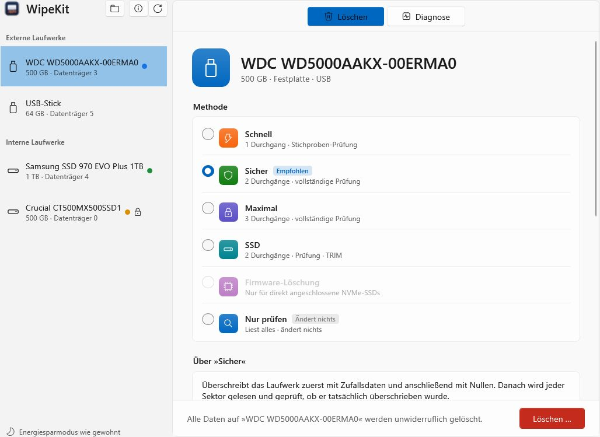
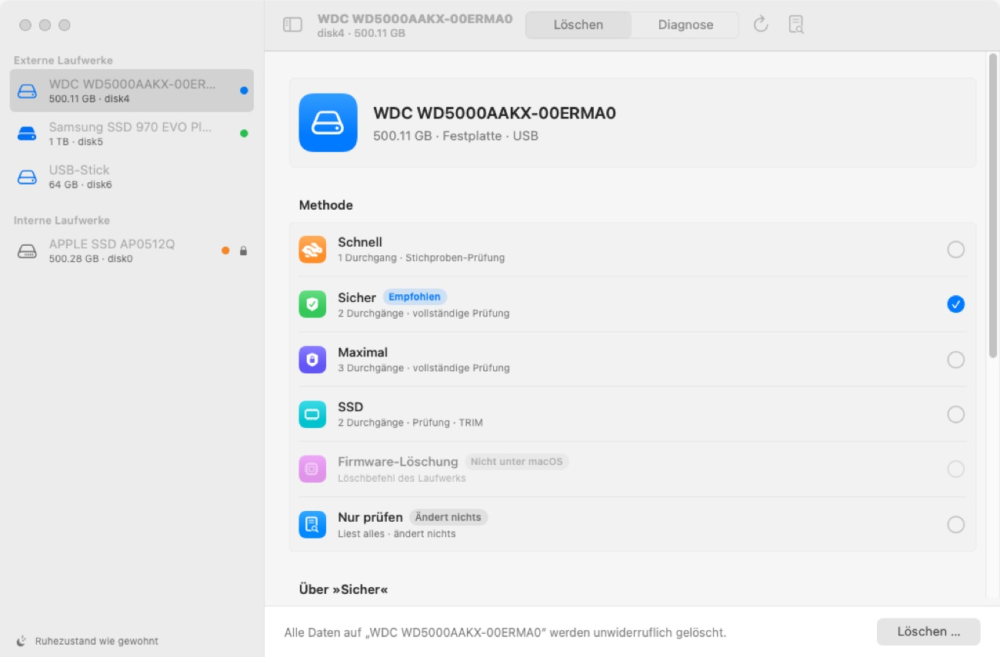
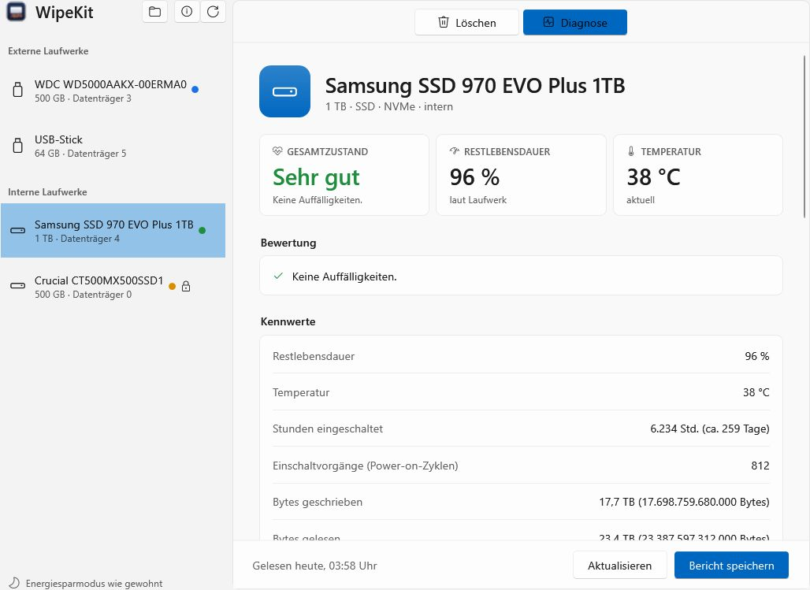
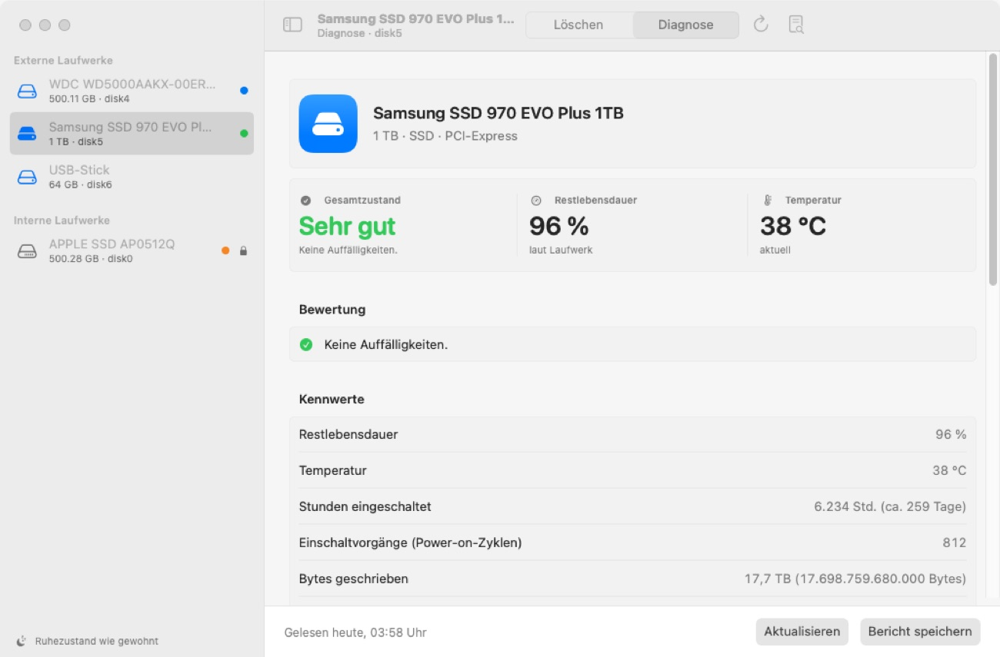
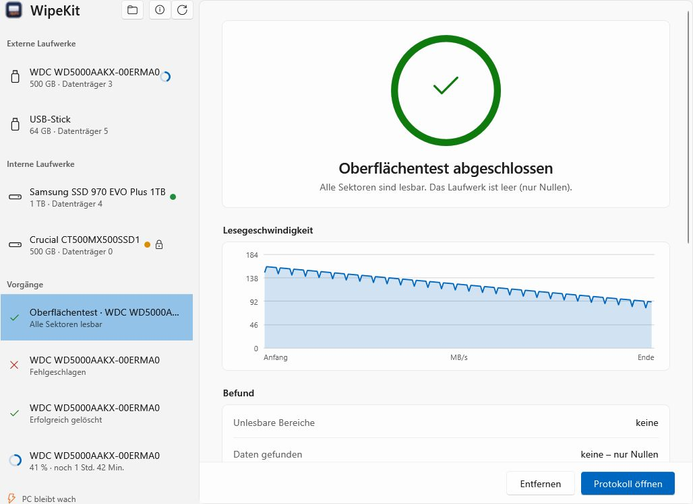
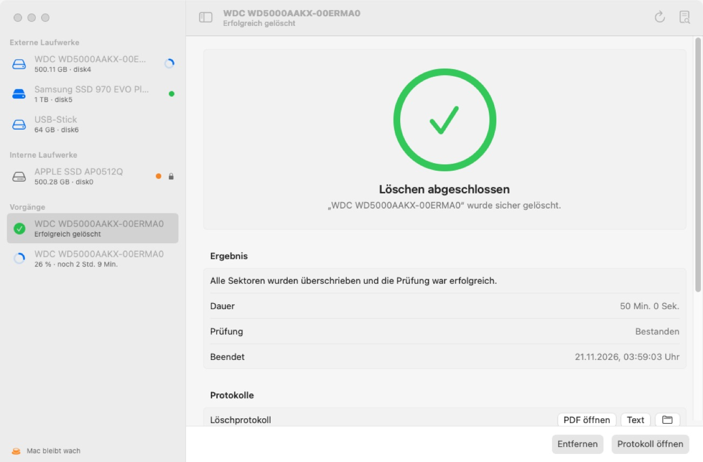

  

<h1 align="center">WipeKit</h1>

  Festplatten, SSDs und USB-Sticks sicher löschen – und ihre Gesundheit prüfen. 
  Für macOS, Windows und Linux.

  <a href="https://github.com/mllsm66/WipeKit/releases/latest"><b>⬇︎ Neueste Version herunterladen</b></a>

---

WipeKit überschreibt ein komplettes Laufwerk so, dass sich die bisherigen Daten nicht wiederherstellen lassen, und zeigt dabei Fortschritt, Geschwindigkeit und Restzeit an. Die **Diagnose** liest die Gesundheitsdaten (S.M.A.R.T.) der Laufwerke aus, bewertet sie mit einem Wort und startet auf Wunsch Selbsttests oder einen Oberflächentest. Zu jedem Vorgang legt WipeKit einen Bericht als **PDF und Text** ab.

## So sieht es aus

| Windows | macOS |
|---------|-------|
|  |  |
|  |  |
|  |  |

## Funktionen

### Löschen

| Methode | Ablauf | Geeignet für |
|---------|--------|--------------|
| **Schnell** | 1× Zufallsdaten → Stichproben-Prüfung (Anfang, Ende, ca. 2.000 Stellen) | Festplatten, wenn es schnell gehen soll |
| **Sicher** | Zufallsdaten → Nullen → vollständige Prüfung | Festplatten mit sensiblen Daten (empfohlen) |
| **Maximal** | 2× Zufallsdaten → Nullen → vollständige Prüfung | Aufträge mit Vorgabe »mehrfach überschreiben« |
| **SSD** | 2× Zufallsdaten → vollständige Prüfung → TRIM | SSDs, USB-Sticks, Speicherkarten |
| **Firmware-Löschung** | Löschbefehl des Laufwerks (Sanitize / Secure Erase) → Kontrolle von Prüfmarken | Interne SATA- und NVMe-SSDs (siehe unten) |
| **Nur prüfen** | Liest alles und prüft, ob das Laufwerk leer ist – ändert nichts | Kontrolle eines gelöschten oder neuen Laufwerks |

- Das Laufwerk, auf dem das System läuft, ist immer gesperrt. Wird zwischendurch umgesteckt, bricht WipeKit ab.
- Der Rechner bleibt während des Vorgangs wach, der Bildschirm darf ausgehen.
- Versteckte Bereiche (HPA) werden unter Linux erkannt und im Protokoll vermerkt.

### Diagnose

- **Gesamtzustand in einem Wort**: Sehr gut · Gut · Bedenklich · Schlecht · Unbekannt – mit Begründung.
- **Kennwerte**: Restlebensdauer (SSD, in %), Temperatur, Stunden eingeschaltet, Einschaltvorgänge, Bytes geschrieben und gelesen, ausstehende, unkorrigierbare und ersetzte Sektoren, CRC-Fehler, Drehzahl, Schnittstelle (SATA 150/300/600, NVMe).
- Alle **S.M.A.R.T.-Attribute** und **NVMe-Werte** im Detail, Selbsttest-Protokoll des Laufwerks.
- **Selbsttests** (Kurz-, Lang- und Transporttest) und ein **Oberflächentest**, der jeden Sektor liest, unlesbare Stellen zählt und die Lesegeschwindigkeit als Kurve zeigt.
- Auch interne Laufwerke werden angezeigt.

### Berichte

| Bericht | Inhalt |
|---------|--------|
| **Gesundheitsbericht** | Alle Gesundheitswerte eines Laufwerks – jederzeit über »Bericht speichern« |
| **Löschprotokoll** | Übersicht (Hersteller, Modell, Größe, Seriennummer, Gesamtzustand) und Ablauf des Löschvorgangs |
| **Löschprotokoll (ausführlich)** | Zusätzlich alle Gesundheitswerte vor und nach dem Löschen |
| **Prüfprotokoll** | Ergebnis von »Nur prüfen« bzw. Oberflächentest |

Ablage: `Dokumente/WipeKit-Protokolle/PDF` und `Dokumente/WipeKit-Protokolle/Text` (in den Einstellungen änderbar).
Dateiname: `Datum_Uhrzeit_HERSTELLER-MODELL-GRÖSSE-SERIENNUMMER_Berichtsart`, z. B.
`2026-11-12_03-03_WESTERN-DIGITAL-WD5000AAKX-00ERMA0-500GB-WD-WCC2EXX12345_Loeschprotokoll.pdf`
(die Seriennummer im Dateinamen lässt sich abschalten). Auf Wunsch stehen „Durchgeführt von“, Firma und
eine Notiz (z. B. Auftragsnummer) im Protokoll.

### Mitteilungen und Benachrichtigungen aufs Handy

- **Mitteilung am Rechner**, wenn ein Vorgang endet oder abbricht – am Mac oben rechts, unter Windows
  unten rechts, unter Linux über die Benachrichtigungen des Desktops. Auf Mac und Linux auch dann,
  wenn WipeKit während des Vorgangs geschlossen wurde.
- **Aufs Handy** (in den Einstellungen wählbar):
  - **[WipeKit Hub](https://github.com/mllsm66/WipeKit-Hub)** – selbst gehostet, mit Übersicht, Bildern und
    beiden PDF-Protokollen. Protokolle und Laufwerksdaten werden **Ende-zu-Ende-verschlüsselt**; nur dein
    Browser kann sie öffnen. Mitteilungen kommen beim iPhone über Apple, ohne Verbindung im Hintergrund.
  - **ntfy** (öffentlicher oder eigener Server) – nur die kurze Mitteilung.
  - **Discord** (Webhook) – nur die kurze Mitteilung.
- Zugangsdaten liegen im Schlüsselbund des Systems (macOS-Schlüsselbund, unter Windows mit DPAPI
  verschlüsselt, unter Linux im Secret Service).

### Updates

„Nach Updates suchen …“ (Mac: App-Menü, Windows und Linux: Einstellungen bzw. Hauptmenü). Beim ersten Start
fragt WipeKit, ob es selbst nach Updates suchen und sie installieren soll. Jedes Update wird vor der
Installation anhand seiner **digitalen Signatur** geprüft; während eines Vorgangs wird nie installiert.

## Unterschiede zwischen den Systemen

| | Windows | macOS | Linux |
|---|---|---|---|
| Gesundheitsdaten interner Laufwerke | ✓ | ✓ | ✓ |
| Gesundheitsdaten über USB | ✓ (je nach Adapter) | ✓ (je nach Adapter, Laufwerk wird kurz ausgeworfen) | ✓ (je nach Adapter) |
| Interne Laufwerke löschen | ✓ nach zusätzlicher Bestätigung | – (nur Diagnose) | ✓ nach zusätzlicher Bestätigung |
| Firmware-Löschung | NVMe-SSDs | – (von macOS nicht freigegeben) | SATA- und NVMe-SSDs |

### Gesundheitsdaten über USB am Mac

macOS gibt die Gesundheitsdaten über USB grundsätzlich nicht an Programme weiter. WipeKit liest sie deshalb **direkt über den USB-Adapter**: Das Laufwerk wird dafür kurz ausgeworfen, das mitgelieferte `smartctl` übernimmt das USB-Gerät für wenige Sekunden und gibt es danach an macOS zurück. Dafür ist das Administrator-Passwort nötig; Daten werden nicht verändert. Beim Löschen geschieht das automatisch vor und nach dem Vorgang. Ob es klappt, hängt vom Adapter ab – Chips von ASMedia, JMicron und Realtek geben die Daten meist weiter. Ohne Umweg lesbar sind interne Laufwerke und NVMe-SSDs in **Thunderbolt-/USB4-Gehäusen**. Selbsttests sind über diesen Weg nicht möglich.

## Download & Installation

Alle Dateien gibt es auf der Seite [**Releases**](https://github.com/mllsm66/WipeKit/releases/latest).

### macOS (ab macOS 13, Intel und Apple Silicon)

1. `WipeKit-macOS-….zip` herunterladen und entpacken.
2. `WipeKit.app` in den Ordner **Programme** ziehen.
3. Beim ersten Öffnen meldet macOS, dass die App nicht überprüft werden kann. Das liegt daran, dass sie nicht bei Apple registriert ist (das kostet Gebühren).
   **Lösung:** *Systemeinstellungen → Datenschutz & Sicherheit* öffnen, nach unten scrollen und bei WipeKit auf **»Trotzdem öffnen«** klicken.
   Alternativ im Terminal: `xattr -dr com.apple.quarantine /Applications/WipeKit.app`

### Windows (Windows 10 und 11, 64 Bit)

- **Installer**: `WipeKit-Windows-Setup-….exe`. Installiert WipeKit mit Startmenü-Eintrag.
- **Portable**: `WipeKit-Windows-Portable-….exe`. Eine einzelne Datei, ohne Installation lauffähig.

Windows SmartScreen warnt eventuell: *»Der Computer wurde durch Windows geschützt«*. Das passiert bei Programmen ohne kostenpflichtiges Code-Zertifikat.
**Lösung:** Auf **»Weitere Informationen« → »Trotzdem ausführen«** klicken.

> Unter Windows muss WipeKit geöffnet bleiben, bis ein Vorgang abgeschlossen ist.

### Linux (z. B. Ubuntu 24.04+, Linux Mint 22+, Debian 13+, Fedora 39+)

- **Ubuntu / Debian / Mint**: `WipeKit-Linux-….deb` herunterladen und per Doppelklick installieren.
  Oder im Terminal: `sudo apt install ./WipeKit-Linux-….deb`
- **Andere Distributionen**: `WipeKit-Linux-….tar.gz` entpacken und `sudo ./install.sh` ausführen.
  Voraussetzungen: Python 3, PyGObject, GTK 4, libadwaita ≥ 1.4, `python3-cryptography` und `smartmontools` (für die Firmware-Löschung zusätzlich `hdparm` und `nvme-cli`).

## Wichtig zu SSDs

SSDs, USB-Sticks und Speicherkarten verteilen Daten intern auf wechselnde Speicherzellen und halten Reservebereiche vor, die von außen nicht erreichbar sind.

- **SSD** füllt das Laufwerk zweimal komplett, prüft alles und gibt danach alle Blöcke per TRIM frei. Damit sind die Daten mit normalen Mitteln praktisch nicht wiederherstellbar; für einzelne Reservezellen gibt es aber keine Garantie.
- **Firmware-Löschung** lässt die SSD sich selbst löschen – einschließlich der Reservebereiche. Das ist die gründlichste Methode; sie orientiert sich am Vorgehen »Purge« nach NIST SP 800-88. Sie funktioniert nur bei direkt angeschlossenen Laufwerken, die den Befehl unterstützen; USB-Adapter leiten ihn meist nicht weiter.

## Haftungsausschluss

WipeKit löscht Daten **unwiderruflich**. Prüfe vor jedem Löschvorgang genau, welches Laufwerk ausgewählt ist. Die Software wird ohne jede Gewährleistung bereitgestellt (siehe [Lizenz](LICENSE)). Die Nutzung erfolgt auf eigenes Risiko. WipeKit ist kein zertifiziertes Löschverfahren im Sinne einer Norm. Hinweise auf NIST SP 800-88 oder DoD 5220.22-M beschreiben nur, an welchem Vorgehen sich eine Methode orientiert; WipeKit ist weder von NIST noch von einer anderen Stelle geprüft oder zertifiziert und steht mit ihnen in keiner Verbindung. Die Gesundheitsbewertung ist eine Einschätzung anhand der Daten des Laufwerks und keine Garantie für dessen Lebensdauer.

## Selbst bauen

| Plattform | Voraussetzung | Befehl |
|-----------|---------------|--------|
| macOS | Xcode Command Line Tools (smartctl wird aus dem Quelltext mitgebaut) | `bash macos/build.sh` |
| Windows | .NET 10 SDK, `smartctl.exe` aus smartmontools 7.5 in `windows/vendor/` | `dotnet publish windows/WipeKit.csproj -c Release -r win-x64 --self-contained -p:PublishSingleFile=true` |
| Linux | `dpkg-deb` | `bash linux/build.sh 1.1.0` |

Bei jedem neuen Release baut GitHub Actions alle Versionen automatisch, testet sie und hängt sie an das Release an.

## Lizenz und Software von Dritten

WipeKit: [MIT](LICENSE) © 2026 mllsm66.

Für die Diagnose verwendet WipeKit das Programm `smartctl` aus [smartmontools](https://www.smartmontools.org) (GPL-2.0-or-later). Es ist unter macOS und Windows als eigenständiges Programm enthalten. Unter Windows unverändert; unter macOS um den USB-Direktzugriff `usbcap:` ergänzt (ebenfalls GPL, siehe `macos/smartctl/`). Der zugehörige Quelltext liegt jedem Release bei (`smartmontools-7.5.tar.gz` und `smartmontools-7.5-wipekit.tar.gz`). Details: [THIRD-PARTY-NOTICES.md](THIRD-PARTY-NOTICES.md). Herstellernamen werden nur beschreibend verwendet.
