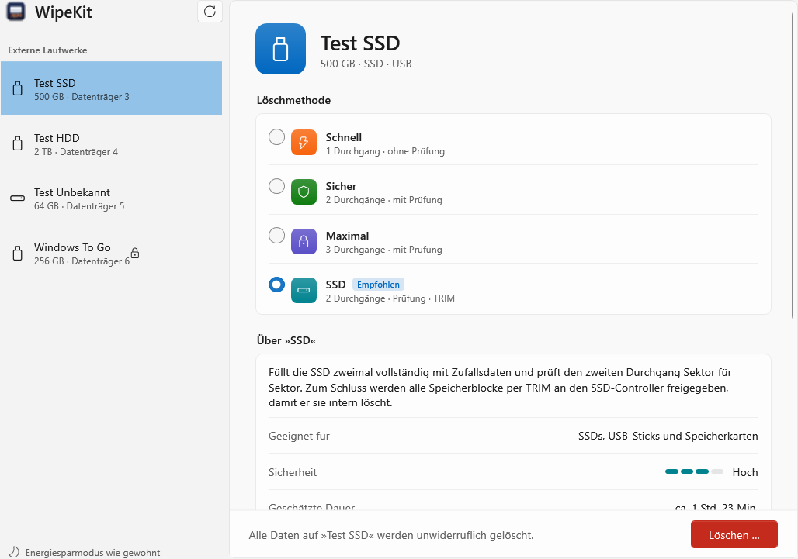
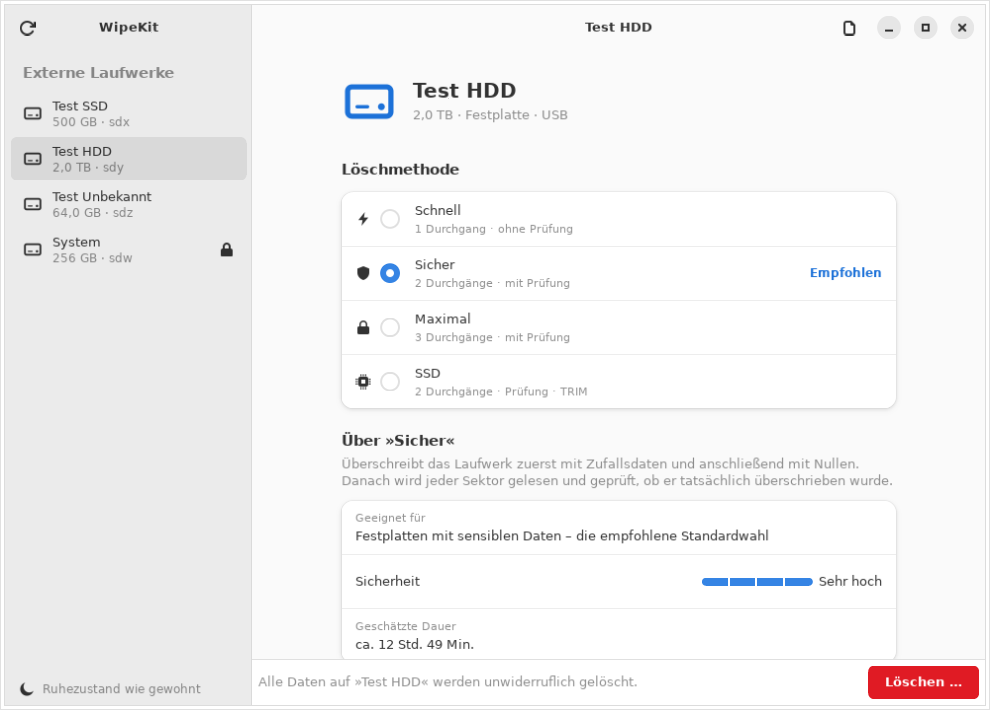
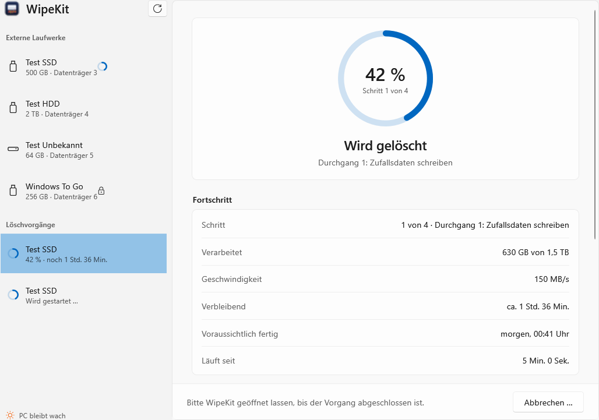
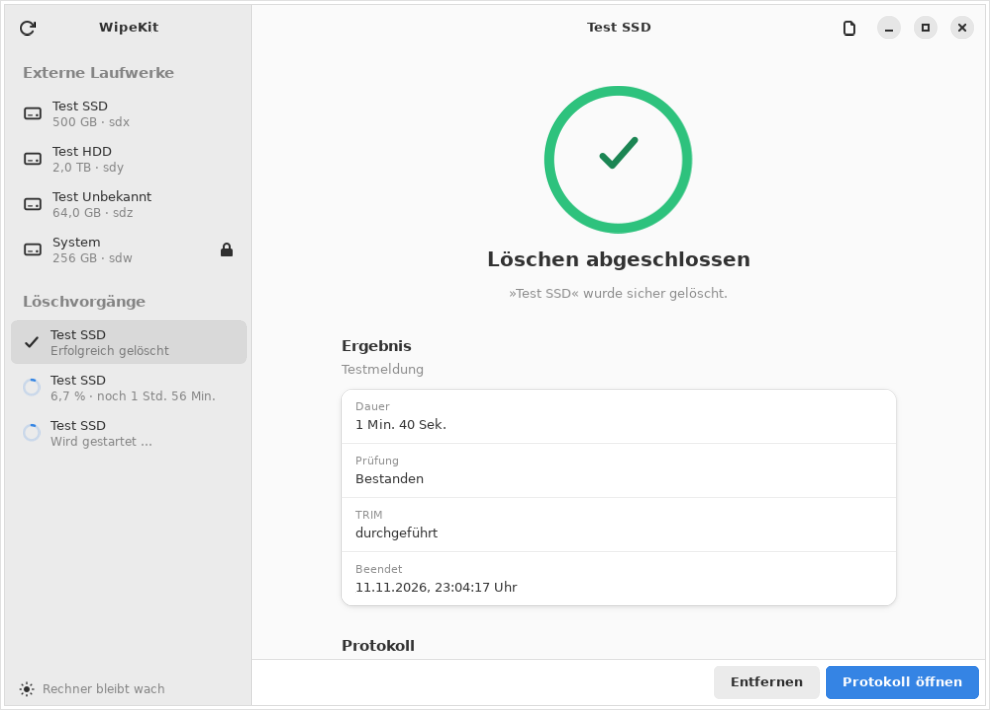

  

<h1 align="center">WipeKit</h1>

  Externe Festplatten, SSDs und USB-Sticks sicher löschen – für macOS, Windows und Linux.

  <a href="https://github.com/mllsm66/WipeKit/releases/latest"><b>⬇︎ Neueste Version herunterladen</b></a>

---

WipeKit überschreibt ein komplettes Laufwerk so, dass sich die bisherigen Daten nicht wiederherstellen lassen. Die App zeigt alle angeschlossenen externen Laufwerke an. Du wählst ein Laufwerk und eine Löschmethode und siehst dann Fortschritt, Geschwindigkeit, Restzeit und die voraussichtliche Uhrzeit, zu der der Vorgang fertig ist. Am Ende legt WipeKit automatisch ein Löschprotokoll ab.

## So sieht es aus

| Windows | Linux |
|---------|-------|
|  |  |
|  |  |

## Funktionen

- **Nur externe Laufwerke**: Das Laufwerk, auf dem das System läuft, ist immer gesperrt.
- **Vier Löschmethoden**:

  | Methode | Ablauf | Geeignet für |
  |---------|--------|--------------|
  | **Schnell** | 1× Zufallsdaten | Festplatten, wenn es schnell gehen soll |
  | **Sicher** | Zufallsdaten → Nullen → vollständige Prüfung | Festplatten mit sensiblen Daten (empfohlen) |
  | **Maximal** | 2× Zufallsdaten → Nullen → vollständige Prüfung | Aufträge mit Vorgabe »mehrfach überschreiben« |
  | **SSD** | 2× Zufallsdaten → vollständige Prüfung → TRIM | SSDs, USB-Sticks, Speicherkarten |

- **Prüfung**: Bei »Sicher«, »Maximal« und »SSD« wird das ganze Laufwerk zurückgelesen und mit den geschriebenen Daten verglichen. So fallen defekte Sektoren und unzuverlässige USB-Adapter auf.
- **Kein Ruhezustand während des Löschens**: Der Rechner bleibt wach, der Bildschirm darf aber ausgehen. Ideal, um große Platten über Nacht löschen zu lassen.
- **Löschprotokoll**: Eine Textdatei mit Laufwerk, Methode, Dauer und Ergebnis, abgelegt unter `Dokumente/WipeKit-Protokolle`.
- **Mehrere Laufwerke gleichzeitig** löschen.
- **Schutz gegen Verwechslungen**: Wird zwischendurch umgesteckt, bricht WipeKit ab.

## Download & Installation

Alle Dateien gibt es auf der Seite [**Releases**](https://github.com/mllsm66/WipeKit/releases/latest).

### macOS (ab macOS 13, Intel und Apple Silicon)

1. `WipeKit-macOS-….zip` herunterladen und entpacken.
2. `WipeKit.app` in den Ordner **Programme** ziehen.
3. Beim ersten Öffnen meldet macOS, dass die App nicht überprüft werden kann. Das liegt daran, dass sie nicht bei Apple registriert ist (das kostet Gebühren).
   **Lösung:** *Systemeinstellungen → Datenschutz & Sicherheit* öffnen, nach unten scrollen und bei WipeKit auf **»Trotzdem öffnen«** klicken.
   Alternativ im Terminal: `xattr -dr com.apple.quarantine /Applications/WipeKit.app`

### Windows (Windows 10 und 11, 64 Bit)

- **Installer**: `WipeKit-Windows-Setup-….exe`. Installiert WipeKit mit Startmenü-Eintrag.
- **Portable**: `WipeKit-Windows-Portable-….exe`. Eine einzelne Datei, ohne Installation lauffähig (z. B. vom USB-Stick).

Windows SmartScreen warnt eventuell: *»Der Computer wurde durch Windows geschützt«*. Das passiert bei Programmen ohne kostenpflichtiges Code-Zertifikat.
**Lösung:** Auf **»Weitere Informationen« → »Trotzdem ausführen«** klicken.

> Unter Windows muss WipeKit geöffnet bleiben, bis der Löschvorgang abgeschlossen ist.

### Linux (z. B. Ubuntu 24.04+, Linux Mint 22+, Debian 13+, Fedora 39+)

- **Ubuntu / Debian / Mint**: `WipeKit-Linux-….deb` herunterladen und per Doppelklick installieren.
  Oder im Terminal: `sudo apt install ./WipeKit-Linux-….deb`
- **Andere Distributionen**: `WipeKit-Linux-….tar.gz` entpacken und `sudo ./install.sh` ausführen.
  Voraussetzungen: Python 3, PyGObject, GTK 4 und libadwaita ≥ 1.4 (Fedora: `sudo dnf install python3-gobject gtk4 libadwaita`).

## Wichtig zu SSDs

SSDs, USB-Sticks und Speicherkarten verteilen Daten intern auf wechselnde Speicherzellen und halten Reservebereiche vor, die von außen nicht erreichbar sind. Der Modus **SSD** füllt das Laufwerk deshalb zweimal komplett mit Zufallsdaten und gibt danach alle Blöcke per TRIM frei. Damit werden bei den meisten SSDs auch die Reservebereiche erfasst.

Eine Garantie für jede einzelne Speicherzelle bietet nur das Firmware-Kommando des Herstellers (»Secure Erase« / »Sanitize«). Das lässt sich über USB-Adapter in der Regel nicht senden. Für hochsensible Daten auf SSDs empfiehlt sich zusätzlich das Tool des Herstellers oder die physische Zerstörung.

## Haftungsausschluss

WipeKit löscht Daten **unwiderruflich**. Prüfe vor jedem Löschvorgang genau, welches Laufwerk ausgewählt ist. Die Software wird ohne jede Gewährleistung bereitgestellt (siehe [Lizenz](LICENSE)). Die Nutzung erfolgt auf eigenes Risiko. WipeKit ist kein zertifiziertes Löschverfahren im Sinne einer Norm.

## Selbst bauen

| Plattform | Voraussetzung | Befehl |
|-----------|---------------|--------|
| macOS | Xcode Command Line Tools | `bash macos/build.sh` |
| Windows | .NET 10 SDK | `dotnet publish windows/WipeKit.csproj -c Release -r win-x64 --self-contained -p:PublishSingleFile=true` |
| Linux | `dpkg-deb` | `bash linux/build.sh 1.0.0` |

Bei jedem neuen Release baut GitHub Actions alle Versionen automatisch und hängt sie an das Release an.

## Lizenz

[MIT](LICENSE) © 2026 mllsm66
